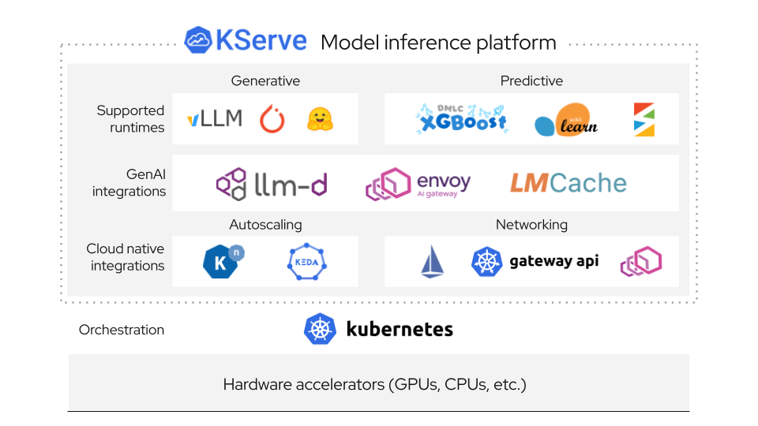

# KServe

[ [English](README.md) | 简体中文 ]

KServe 是一个标准化的分布式生成式与预测式 AI 推理平台，用于在 Kubernetes 上进行可扩展的多框架模型部署。

KServe 目前已被[众多组织和企业采用](https://kserve.github.io/website/docs/community/adopters)，并且是[云原生计算基金会（CNCF）](https://www.cncf.io/)旗下的孵化项目（Incubating Project）。

更多详情请访问 [KServe 官方网站](https://kserve.github.io/website/)。

### 为什么选择 KServe？

在 Kubernetes 上统一生成式 AI 与预测式 AI 推理的单一平台。不仅简单易用、可快速上手部署，同时功能强大，能够以丰富的高级特性稳定承载企业级大规模 AI 工作负载。

### 核心特性

**生成式 AI (Generative AI)**
  * 🧮 **推理后端深度优化**：支持 vLLM 与 llm-d，为大语言模型（LLM）提供极致优化的服务性能
  * 📌 **推理协议标准化**：兼容 OpenAI 推理协议标准，无缝对接各类 LLM 应用生态
  * 🚅 **GPU 硬件加速**：支持 GPU 高性能推理及面向大模型的显存深度优化管理
  * 💾 **智能模型缓存**：内置智能模型缓存机制，显著缩短加载时间并降低高频访问模型的响应延迟
  * 🗂️ **KV Cache 卸载**：支持将 KV Cache 卸载至 CPU 内存或磁盘的高级显存管理能力，高效支撑更长上下文序列
  * 📈 **智能自动扩缩容**：专为生成式 AI 工作负载特征定制的基于请求的弹性自动扩缩容能力
  * 🔧 **原生支持 Hugging Face**：开箱即用原生集成 Hugging Face 模型生态，大幅简化模型部署工作流

**预测式 AI (Predictive AI)**
  * 🧮 **多框架广泛兼容**：全面支持 TensorFlow、PyTorch、scikit-learn、XGBoost、ONNX 等主流机器学习框架
  * 🔀 **智能请求路由**：在 Predictor（预测器）、Transformer（转换器）和 Explainer（解释器）组件间实现无缝请求路由与自动流量管理
  * 🔄 **高级发布编排**：通过 InferenceGraph 原生支持金丝雀发布（Canary Rollouts）、多步推理流水线以及集成推理（Ensembles）
  * ⚡ **弹性无服务器扩缩**：针对预测类工作负载支持基于请求的自动扩缩容以及缩容至零（Scale-to-zero）
  * 🔍 **模型可解释性**：内置模型解释与特征归因（Feature Attribution）支持，直观洞察模型预测推理依据
  * 📊 **全方位高级监控**：支持请求载荷日志（Payload Logging）、异常点检测（Outlier Detection）、对抗样本检测（Adversarial Detection）与数据漂移检测（Drift Detection）
  * 💰 **极高成本效益**：当闲置不使用时自动将昂贵计算资源缩容至零，大幅降低基础设施成本

### 了解更多
如需深入了解 KServe 的各项特性、如何配置与使用各项已支持的功能，或如何参与 KServe 开源社区，请参阅 [KServe 官方文档网站](https://kserve.github.io/website)。此外，我们还整理了一系列[技术演讲与演示视频合集](https://kserve.github.io/website/docs/community/presentations)，助您全方位深入掌握架构细节。

### :hammer_and_wrench: 安装部署

#### 独立部署 (Standalone Installation)
- **[标准 Kubernetes 部署](https://kserve.github.io/website/docs/admin-guide/overview#raw-kubernetes-deployment)**：相比无服务器（Serverless）部署模式更加**轻量级**，但该选项不支持金丝雀发布以及基于请求的缩容至零（Scale-to-zero）自动扩缩容。
- **[Knative 无服务器部署](https://kserve.github.io/website/docs/admin-guide/overview#serverless-deployment)**：KServe 默认安装 Knative，为 InferenceService 提供完备的 **Serverless 无服务器部署**能力。
- **[ModelMesh 多模型部署](https://kserve.github.io/website/docs/admin-guide/overview#modelmesh-deployment)**：您也可以选择安装 ModelMesh，以支撑**超大规模**、**高密度**以及**模型高频变更**的推理服务场景。
- **[快速上手安装](https://kserve.github.io/website/docs/getting-started/quickstart-guide)**：在您的本地开发机上快速安装与体验 KServe。

#### Kubeflow 集成部署 (Kubeflow Installation)
KServe 是 Kubeflow 生态中的重要扩展组件，更多详情请参阅 [Kubeflow KServe 官方文档](https://www.kubeflow.org/docs/external-add-ons/kserve/kserve)。您还可以查阅在 [AWS 平台](https://awslabs.github.io/kubeflow-manifests/main/docs/component-guides/kserve) 或 [OpenShift 容器平台](https://github.com/kserve/kserve/blob/master/docs/OPENSHIFT_GUIDE.md) 上的专项运行指南。

### :flight_departure: [创建您的首个 InferenceService](https://kserve.github.io/website/docs/getting-started/genai-first-isvc)

### :bulb: [项目路线图 (Roadmap)](./ROADMAP.md)

### :blue_book: [InferenceService API 参考文档](https://kserve.github.io/website/docs/reference/crd-api)

### :toolbox: [开发者指南](https://kserve.github.io/website/docs/developer-guide)

### :writing_hand: [贡献者指南](https://kserve.github.io/website/docs/developer-guide/contribution)

### :handshake: [采用机构 (Adopters)](https://kserve.github.io/website/docs/community/adopters)

### 贡献者列表

由衷感谢所有出色的开源社区贡献者！

---

> **免责声明**：本文档由社区志愿者维护与翻译。如翻译内容与英文原文存在出入，请以英文原版为准。
