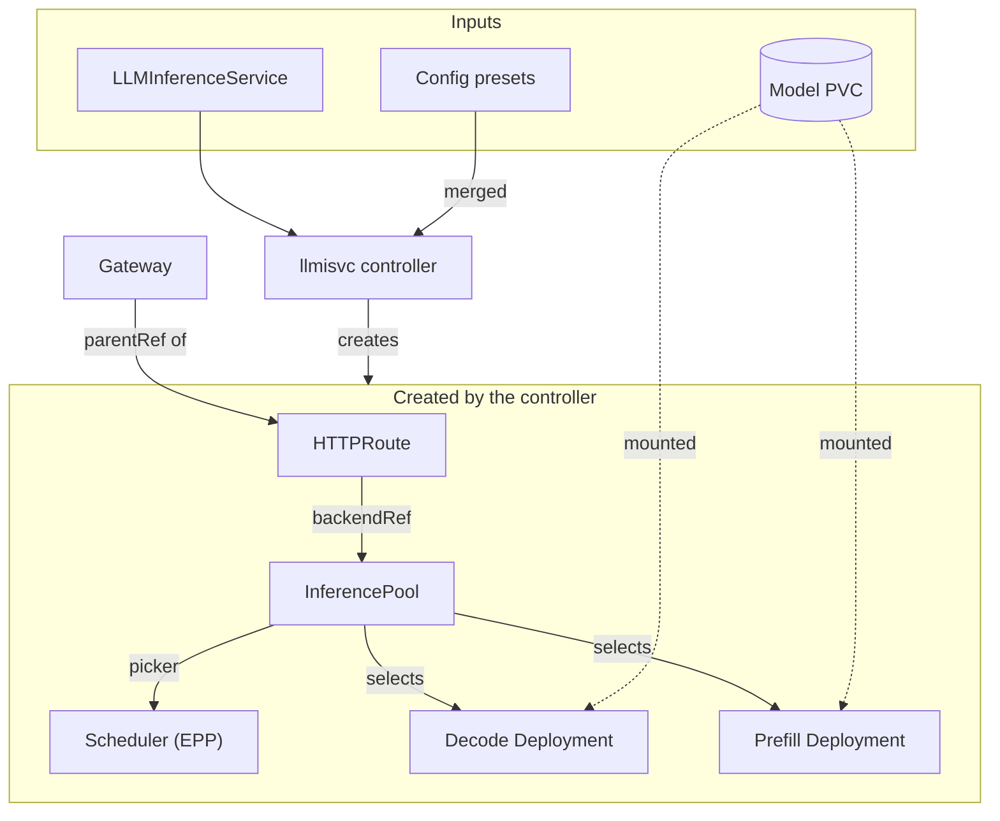
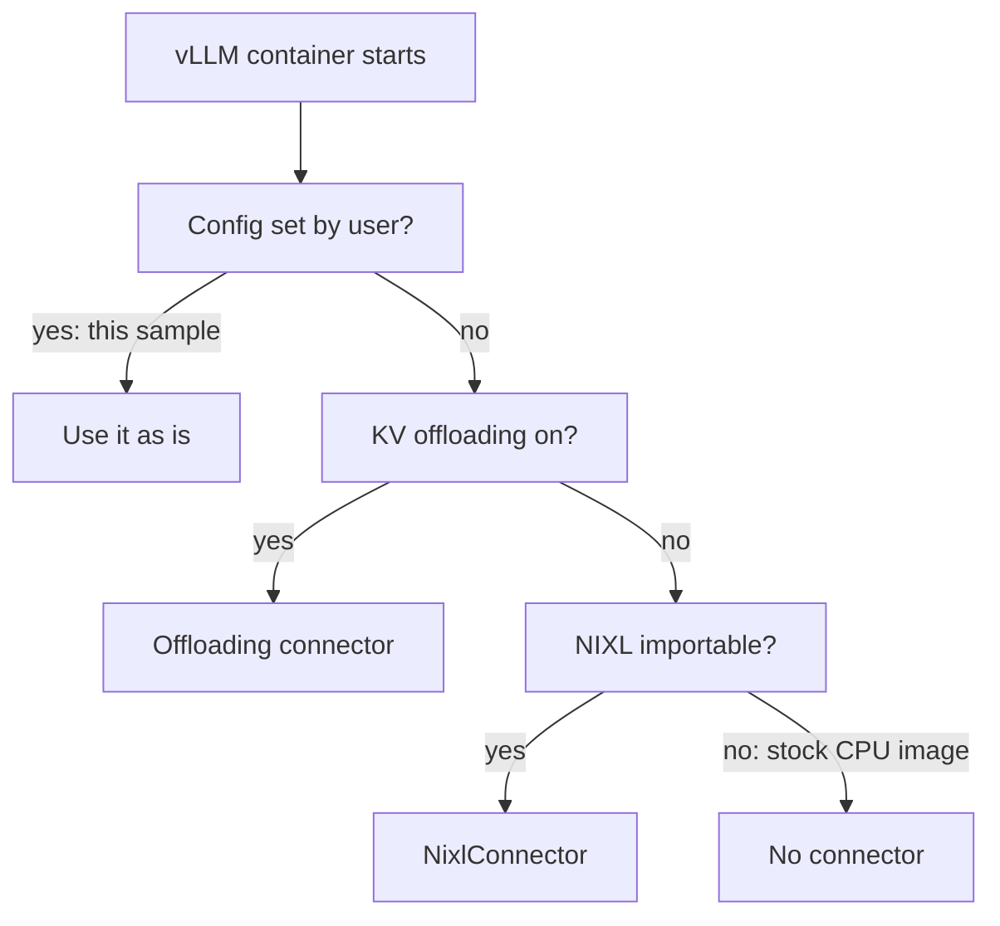
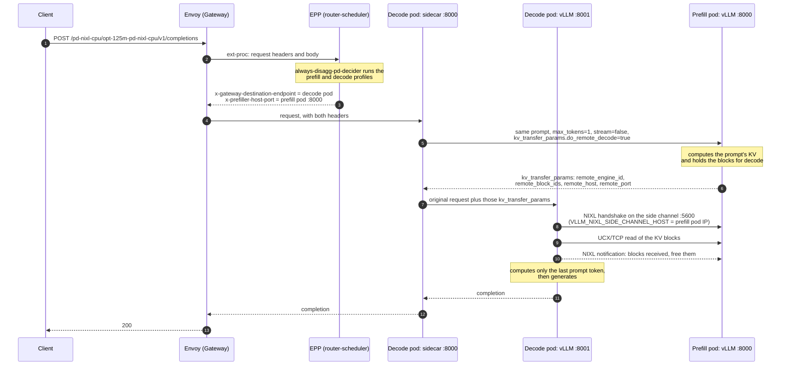
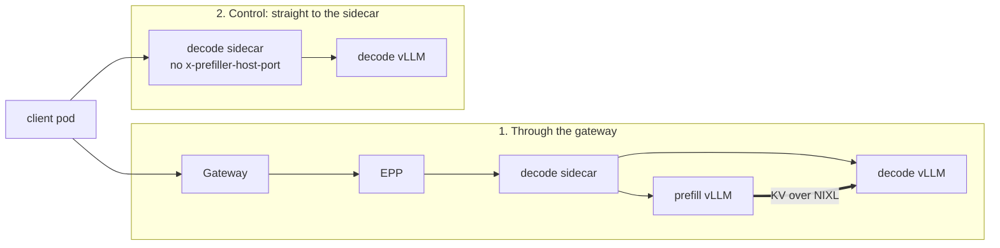

# Prefill/Decode Disaggregation on CPU with a Real NIXL KV Transfer

This sample runs `LLMInferenceService` prefill/decode (P/D) disaggregation on CPU only,
with the prompt's KV cache actually moving from the prefill pod to the decode pod over
[NIXL](https://github.com/ai-dynamo/nixl) (UCX over TCP). It comes with a script that
proves the transfer happened, not just that a request returned 200.

It exists because the CPU P/D e2e tests (`workload-pd-cpu`) exercise the scheduler's
prefill and decode profiles, the routing sidecar and both workloads, but:

- they assert only `200` with `choices`, which a request served by decode alone also
  passes, and
- the stock `vllm/vllm-openai-cpu` image ships without NIXL, so the preset leaves
  `--kv-transfer-config` unset and decode recomputes the whole prompt. No KV moves.

Here a custom image adds NIXL, both workloads set a NixlConnector config, and
`validate.sh` checks vLLM's own counters on both pods.
Adding these checks to the e2e suite is tracked in
[kserve#6462](https://github.com/kserve/kserve/issues/6462).

> This is a functional check of the P/D data path, not a performance setup. On CPU a
> disaggregated request is slower than serving it from one pod.

## Contents

| File | What it does |
|---|---|
| `Dockerfile` | `vllm/vllm-openai-cpu:v0.19.0` plus NIXL 0.10.1 (UCX backend). Build arg `DISABLE_ONEDNN_GEMM` is the Apple-silicon workaround. |
| `model-pvc.yaml` | PVC plus a Job that downloads `facebook/opt-125m` into it once, fetching only the files vLLM reads. |
| `llm-inference-service-pd-nixl-cpu.yaml` | The P/D `LLMInferenceService`, mirroring the e2e `router-managed` + `workload-pd-cpu` + opt-125m case. |
| `run.sh` | Build, smoke test, fill the PVC, deploy, validate. |
| `validate.sh` | Sends one request through the gateway and one straight to decode, and asserts on the counter deltas. |

`${VLLM_NIXL_CPU_IMAGE}` in the manifests is a placeholder that `run.sh` fills in with
the image it built.

## How it works

### Control plane: what the controller creates

The service sets `spec.prefill`, so the controller merges the decode and prefill presets
under the spec and, because the service has a managed scheduler and no EPP config of its
own, also the default P/D endpoint-picker config, which uses `always-disagg-pd-decider`.



The controller, the presets and the Gateway are in the `kserve` namespace; everything else is
in the sample's namespace, `pd-nixl-cpu`.

| Object | Name | Role |
|---|---|---|
| Decode Deployment | `opt-125m-pd-nixl-cpu-kserve` | Routing sidecar on :8000 in front of vLLM on :8001; label `llm-d.ai/role=decode` |
| Prefill Deployment | `opt-125m-pd-nixl-cpu-kserve-prefill` | vLLM on :8000; label `llm-d.ai/role=prefill` |
| Scheduler (EPP) | `opt-125m-pd-nixl-cpu-kserve-router-scheduler` | Endpoint picker running `always-disagg-pd-decider` |
| InferencePool | `opt-125m-pd-nixl-cpu-inference-pool` | Selects the decode and prefill pods; its endpoint picker is the EPP |
| HTTPRoute | `opt-125m-pd-nixl-cpu-kserve-route` | Attached to the `kserve-ingress-gateway` Gateway; routes to the InferencePool |
| Model PVC | `opt-125m-model` | Filled once by the `opt-125m-model-download` Job; mounted read-only at `/mnt/models` in both workloads |
| Gateway | `kserve-ingress-gateway` | The HTTPRoute's parent; Envoy Gateway in the tested setup |
| Config presets | `kserve-config-llm-decode-template`, `-prefill-template`, `-scheduler`, `-scheduler-eppconfig-default-pd`, `-router-route` | Merged under the service's spec |

With the `DisaggregatedSet` feature gate off (the default), prefill and decode are two
plain Deployments.

### How the preset picks a KV connector

The decode and prefill presets launch vLLM from a shell script that decides the
`--kv-transfer-config` when the container starts. This is why the stock CPU image never
transfers KV, and why this sample sets the flag itself.



- **Config set by user:** `--kv-transfer-config` appears in `VLLM_ADDITIONAL_ARGS` or the
  container `args`.
- **KV offloading on:** `KSERVE_KV_TRANSFER_ARGS` is set and vLLM is 0.22 or later.
- **NIXL importable:** `python3 -c 'import nixl'` succeeds. The preset then injects
  `NixlConnector` as `kv_producer` on prefill and `kv_consumer` on decode.
- **No connector:** decode recomputes the prompt itself, which is what the stock CPU image
  gets.

The sample passes the config through `VLLM_ADDITIONAL_ARGS`, with the JSON in single
quotes. The preset expands both that variable and the container `args` inside `eval`, so
unquoted JSON is re-parsed by the shell. The double quotes are removed and brace
expansion splits it: `{"kv_connector":"NixlConnector","kv_role":"kv_both"}` reaches vLLM
as two words, `kv_connector:NixlConnector` and `kv_role:kv_both`.

### Data plane: one request, end to end

The EPP picks a decode pod and a prefill pod for every request, and the routing sidecar
in the decode pod runs the prefill step before handing the request to its own vLLM. The
decode engine then pulls the KV blocks from the prefill engine with NIXL.



The presets set `VLLM_NIXL_SIDE_CHANNEL_HOST` to the pod IP. Its default, `localhost`,
cannot be reached from another pod.

### What the validation measures

`validate.sh` sends two requests from an in-cluster client pod and reads Prometheus
counters from both vLLM engines before and after each one.



| Counter | Read from | Through the gateway | Control |
|---|---|---|---|
| `vllm:request_success_total` | prefill | +1 (its `max_tokens=1` request) | +0 |
| `vllm:prompt_tokens_by_source_total{source="external_kv_transfer"}` | decode | about the prompt length | +0 |
| `vllm:prompt_tokens_by_source_total{source="local_compute"}` | decode | +1 (the last token) | the prompt length |
| `vllm:nixl_bytes_transferred_count` / `_sum` | decode | +1 / > 0 | +0 |
| `vllm:nixl_num_failed_transfers_total` | decode | +0 | +0 |

Both requests return 200, which is why a status-code check alone cannot tell them apart.
The control proves the counters do: decode served it alone and the prefill counter did
not move.

With `EXPECT_KV_TRANSFER=false`, `validate.sh` checks only the prefill counter. That is
the assertion that works without NIXL, where prefill is still called but no KV moves; see
[Without NIXL](#without-nixl).

## Prerequisites

- A cluster running the llmisvc controller, its `LLMInferenceServiceConfig` presets,
  Gateway API, Gateway API Inference Extension CRDs and a Gateway. For example,
  `hack/setup/quick-install/llmisvc-full-install-with-manifests.sh` installs these with
  Envoy Gateway and the `kserve-ingress-gateway` Gateway.
- Room for two vLLM pods (2 CPU and 7Gi limits each) next to the EPP and the gateway.
  A minikube node needs about **6 CPUs and 14 GiB**; see
  [Node sizing](#node-sizing-on-minikube).
- Docker, to build the image. On minikube, `run.sh` builds straight into the node.
- Network access to Hugging Face from the cluster (model files) and from Docker (the
  smoke test fetches the model config).

```bash
minikube start -p pd-nixl-cpu --cpus 6 --memory 14g
```

## Run it

```bash
cd docs/samples/llmisvc/pd-nixl-cpu
MINIKUBE_PROFILE=pd-nixl-cpu ./run.sh
```

On any other cluster, build to a registry the nodes can pull from:

```bash
VLLM_NIXL_CPU_IMAGE=<registry>/vllm-openai-cpu-nixl:v0.19.0-nixl0.10.1 PUSH=true \
  KUBE_CONTEXT=<context> ./run.sh
```

`run.sh`:

1. Builds the image. On Apple silicon it sets `DISABLE_ONEDNN_GEMM=true` and adds a
   `-noonednn` suffix to the default tag.
2. Runs a smoke test of about a minute: `vllm serve` with dummy weights and the
   NixlConnector config, in plain Docker. It stops here if the image cannot serve on this
   machine, before any cluster work.
3. Fills the model PVC (about 3 minutes on a slow link).
4. Deploys the service and waits for `Ready`. Each pod spends a few minutes in the CPU
   warm-up compile.
5. Runs `validate.sh`, which exits non-zero if any check fails.

Re-run `validate.sh` on its own at any time; it only reads counter deltas.

### Step by step

```bash
IMAGE=kserve-dev/vllm-openai-cpu-nixl:v0.19.0-nixl0.10.1
eval "$(minikube -p pd-nixl-cpu docker-env)"     # minikube only
docker build -t "$IMAGE" .                        # add --build-arg DISABLE_ONEDNN_GEMM=true on Apple silicon

kubectl create namespace pd-nixl-cpu
sed "s|\${VLLM_NIXL_CPU_IMAGE}|$IMAGE|g" model-pvc.yaml | kubectl apply -n pd-nixl-cpu -f -
kubectl wait -n pd-nixl-cpu --for=condition=Complete job/opt-125m-model-download --timeout=30m

sed "s|\${VLLM_NIXL_CPU_IMAGE}|$IMAGE|g" llm-inference-service-pd-nixl-cpu.yaml | kubectl apply -n pd-nixl-cpu -f -
kubectl wait -n pd-nixl-cpu --for=condition=Ready llminferenceservice/opt-125m-pd-nixl-cpu --timeout=20m

VLLM_NIXL_CPU_IMAGE=$IMAGE ./validate.sh
```

### Without NIXL

To check the configuration the `workload-pd-cpu` e2e cases run, use an image without
NIXL and drop `VLLM_ADDITIONAL_ARGS`. Both pods then log
`[kv-transfer] NIXL not available, P/D KV transfer stays disabled`. The sidecar still
sends the prefill request, so the prefill counter still separates the two paths, while
decode recomputes the whole prompt:

```bash
# Apple silicon only. On x86, skip the build and use vllm/vllm-openai-cpu:v0.19.0 directly.
docker build -t kserve-dev/vllm-openai-cpu:v0.19.0-baseline - <<'EOF'
FROM vllm/vllm-openai-cpu:v0.19.0
RUN f="$(python3 -c 'import os, vllm; print(os.path.dirname(vllm.__file__))')/_custom_ops.py" \
 && sed -i 's/^_supports_onednn = .*/_supports_onednn = False/' "$f"
EOF

sed "s|\${VLLM_NIXL_CPU_IMAGE}|kserve-dev/vllm-openai-cpu:v0.19.0-baseline|g" llm-inference-service-pd-nixl-cpu.yaml \
  | yq 'del(.spec.template.containers[0].env[] | select(.name == "VLLM_ADDITIONAL_ARGS"))
        | del(.spec.prefill.template.containers[0].env[] | select(.name == "VLLM_ADDITIONAL_ARGS"))' \
  | kubectl apply -n pd-nixl-cpu -f -
EXPECT_KV_TRANSFER=false ./validate.sh
```

## Tested with

`run.sh` passed all nine checks on single-node minikube (Kubernetes v1.33.1, 6 CPUs /
14 GiB) on an Apple M4 Pro, with the llmisvc controller from `master` at `6605032e9`,
Envoy Gateway v1.8.1, llm-d router v0.11.0, vLLM 0.19.0+cpu and NIXL 0.10.1. Through the
gateway, decode received 75 prompt tokens over NIXL (4,718,592 bytes, one 128-token KV
block) and computed only the last one. The [no-NIXL variant](#without-nixl) passed with
prefill +1 through the gateway and +0 straight to decode.

## Workarounds

Each of these was needed to get the sample running.

### NIXL 0.10.1 instead of vLLM v0.19's pinned range

vLLM v0.19.0 declares `nixl >= 0.7.1, < 0.10.0`, and its CPU image ships no NIXL. In that
range the binaries come from `nixl-cu12`, and every wheel (0.7.1, 0.8.0 and 0.9.0, on
x86_64 and aarch64) links its UCX plugin against `libcuda.so.1`, so on CPU it fails to
load:

```
Failed to load plugin from .../libplugin_UCX.so: libcuda.so.1: cannot open shared object file
```

0.10.0 is the first release without that link. The image pins both `nixl` and
`nixl-cu12` to 0.10.1, the highest version vLLM v0.20.0 accepts.

### `--kv-transfer-config` supplied by the user

The sample sets `kv_both` with `kv_buffer_device=cpu`, which the preset never overrides.
On the CPU platform NixlConnector registers the KV cache directly as `DRAM`
(`use_host_buffer: False`), so no staging buffer is involved. `UCX_TLS=tcp,self` makes
the transport explicit. The preset's own `kv_producer`/`kv_consumer` injection was not
tested here.

### Apple silicon: oneDNN `SIGILL` (`DISABLE_ONEDNN_GEMM`)

On Docker Desktop on Apple silicon, the stock arm64 image kills its engine core right
after loading weights, with or without NIXL:

```
Fatal Python error: Illegal instruction
  File ".../vllm/_custom_ops.py", line 2996 in create_onednn_mm
```

Without `PYTHONFAULTHANDLER=1` the only symptom is
`Engine core initialization failed ... Failed core proc(s): {}`.
`ONEDNN_MAX_CPU_ISA=ASIMD` does not help, and the cause is not confirmed.
`DISABLE_ONEDNN_GEMM=true` makes vLLM take its `torch.nn.functional.linear` fallback. It
is off by default and not needed on x86.

### No NUMA nodes: `VLLM_CPU_OMP_THREADS_BIND=nobind`

Docker Desktop's VM has no `/sys/devices/system/node`, so vLLM's per-NUMA thread binding
fails with `Not enough allowed NUMA nodes ... Allowed NUMA nodes are []`. `nobind` skips
the binding; on hosts with NUMA it only gives up thread pinning.

### Node sizing on minikube

With the Docker driver, the kubelet reports the whole Docker VM as allocatable, while the
node container is capped by minikube's `--cpus` and `--memory` (4 CPUs and 8 GiB on the
node tested). Both vLLM pods get scheduled and then run short:

- Prefill was `OOMKilled` during warm-up, at the node container's cgroup rather than the
  pod's.
- The EPP and Envoy restarted on liveness timeouts. One restart left Envoy draining, with
  `/ready` at 503, until its pod was deleted.

Start minikube with `--cpus 6 --memory 14g`, or raise a running node with
`docker update --cpus 6 --memory 14g --memory-swap 14g <profile>`.

### Model download: PVC and parallel ranges

With `hf://`, every pod downloads the whole opt-125m repo (753 MB, two thirds of it TF
and Flax weights) on each rollout and crash, and Hugging Face throttles each connection
to roughly 150-250 KB/s. The Job fetches only the files vLLM reads, as 48 parallel byte
ranges (about 3 minutes for the 250 MB weights), checks the LFS sha256, and fills a PVC
that both pods mount through `pvc://`.

## Troubleshooting

| Symptom | Likely cause | Fix |
|---|---|---|
| Smoke test: `Fatal Python error: Illegal instruction` in `create_onednn_mm` | Apple silicon | `DISABLE_ONEDNN_GEMM=true` |
| `Not enough allowed NUMA nodes ... []` | VM without NUMA sysfs | `VLLM_CPU_OMP_THREADS_BIND=nobind` (already set) |
| Build fails at `assert 'UCX' in ...` | A NIXL wheel whose UCX plugin needs `libcuda` | Keep `NIXL_VERSION` at 0.10.x for vLLM v0.19 |
| Engine core exits with no traceback | Native crash or OOM kill | Re-run with `PYTHONFAULTHANDLER=1`; check `kubectl describe pod` and the node's `dmesg` |
| `OOMKilled` during warm-up, or probes timing out | Node container smaller than the kubelet thinks | [Node sizing](#node-sizing-on-minikube) |
| Gateway request fails to connect, Envoy pod 1/2 ready | Envoy stuck draining after a liveness kill | Delete the Envoy pod |
| vLLM fails at startup parsing `--kv-transfer-config` | Unquoted JSON was split and stripped by the preset's `eval` | Wrap the JSON in single quotes |
| New pods slow, old ones still crash-looping after a fix | The rollout keeps the old ReplicaSet until the new pod is available | Scale the old ReplicaSet to 0 |
| `validate.sh`: prefill +1 but KV transfer +0 | No connector: image without NIXL, or the config was not applied | Check for `NIXL is available` and `Registering KV_Caches` in both pods' logs |

## Clean up

```bash
kubectl delete namespace pd-nixl-cpu
minikube delete -p pd-nixl-cpu     # if you created the profile for this
```
