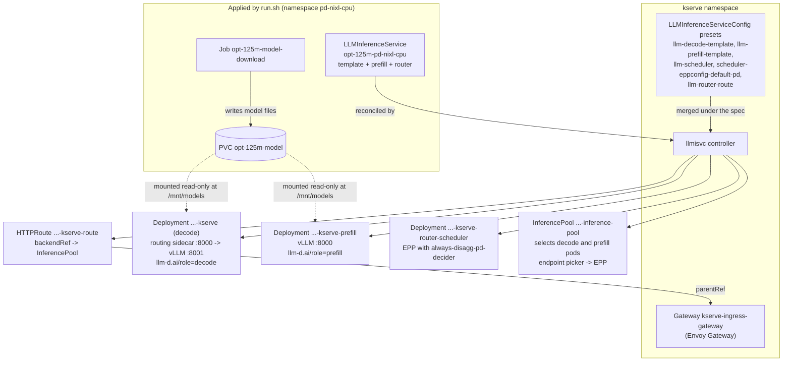
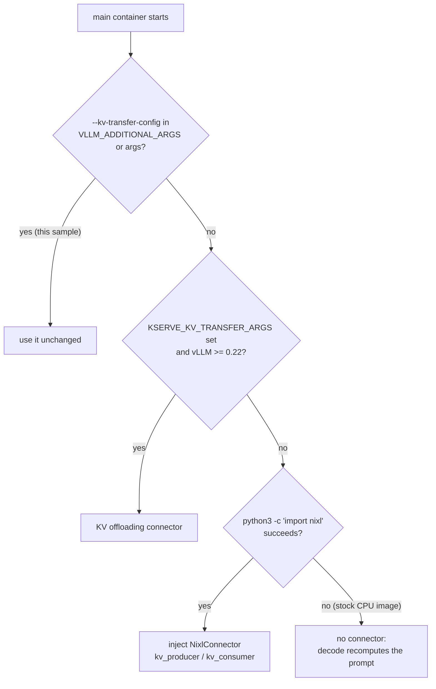
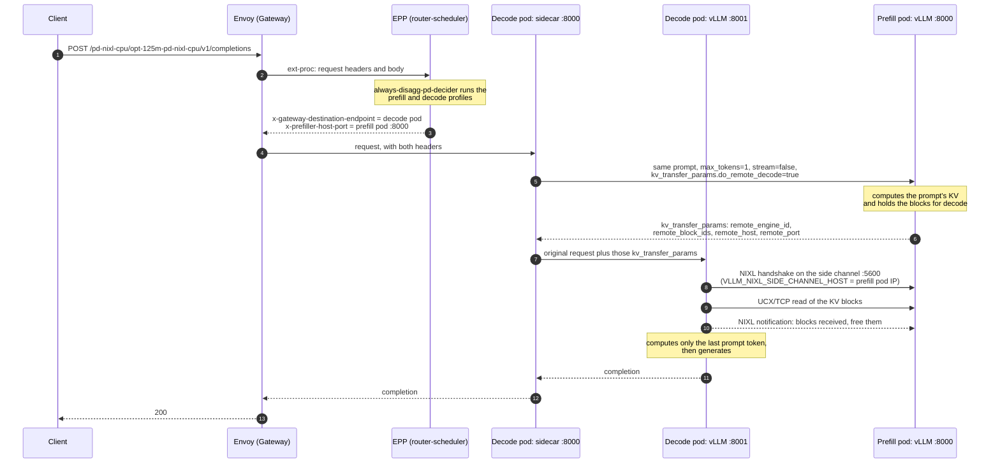
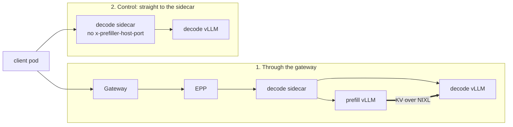

# Prefill/Decode Disaggregation on CPU with a Real NIXL KV Transfer

This sample runs `LLMInferenceService` prefill/decode (P/D) disaggregation on CPU only,
with the prompt's KV cache actually moving from the prefill pod to the decode pod over
[NIXL](https://github.com/ai-dynamo/nixl) (UCX over TCP). It comes with a script that
proves the transfer happened, not just that a request returned 200.

It exists because the CPU P/D e2e tests (`workload-pd-cpu`) exercise the scheduler's
prefill and decode profiles, the routing sidecar and both workloads, but:

- they assert only `200` with `choices`, which a request served by decode alone also
  passes, and
- the stock `vllm/vllm-openai-cpu` image ships without NIXL, so the preset leaves
  `--kv-transfer-config` unset and decode recomputes the whole prompt. No KV moves.

Here a custom image adds NIXL, both workloads set a NixlConnector config, and
`validate.sh` checks vLLM's own counters on both pods.

> This is a functional check of the P/D data path, not a performance setup. On CPU a
> disaggregated request is slower than serving it from one pod.

## Contents

| File | What it does |
|---|---|
| `Dockerfile` | `vllm/vllm-openai-cpu:v0.19.0` plus NIXL 0.10.1 (UCX backend). Build arg `DISABLE_ONEDNN_GEMM` is the Apple-silicon workaround. |
| `model-pvc.yaml` | PVC plus a Job that downloads `facebook/opt-125m` into it once, fetching only the files vLLM reads. |
| `llm-inference-service-pd-nixl-cpu.yaml` | The P/D `LLMInferenceService`, mirroring the e2e `router-managed` + `workload-pd-cpu` + opt-125m case. |
| `run.sh` | Build, smoke test, fill the PVC, deploy, validate. |
| `validate.sh` | Sends one request through the gateway and one straight to decode, and asserts on the counter deltas. |

`${VLLM_NIXL_CPU_IMAGE}` in the manifests is a placeholder that `run.sh` fills in with
the image it built.

## How it works

### Control plane: what the controller creates

The service sets `spec.prefill`, so the controller merges the decode and prefill presets
under the spec and, because the service has a managed scheduler and no EPP config of its
own, also the default P/D endpoint-picker config, which uses `always-disagg-pd-decider`.



With the `DisaggregatedSet` feature gate off (the default), prefill and decode are two
plain Deployments.

### How the preset picks a KV connector

The decode and prefill presets launch vLLM from a shell script that decides the
`--kv-transfer-config` when the container starts. This is why the stock CPU image never
transfers KV, and why this sample sets the flag itself.



The sample passes the config through `VLLM_ADDITIONAL_ARGS`, with the JSON in single
quotes. The preset expands both that variable and the container `args` inside `eval`, so
unquoted JSON is re-parsed by the shell. The double quotes are removed and brace
expansion splits it: `{"kv_connector":"NixlConnector","kv_role":"kv_both"}` reaches vLLM
as two words, `kv_connector:NixlConnector` and `kv_role:kv_both`.

### Data plane: one request, end to end

The EPP picks a decode pod and a prefill pod for every request, and the routing sidecar
in the decode pod runs the prefill step before handing the request to its own vLLM. The
decode engine then pulls the KV blocks from the prefill engine with NIXL.



The presets set `VLLM_NIXL_SIDE_CHANNEL_HOST` to the pod IP. Its default, `localhost`,
cannot be reached from another pod.

### What the validation measures

`validate.sh` sends two requests from an in-cluster client pod and reads Prometheus
counters from both vLLM engines before and after each one.



| Counter | Read from | Through the gateway | Control |
|---|---|---|---|
| `vllm:request_success_total` | prefill | +1 (its `max_tokens=1` request) | +0 |
| `vllm:prompt_tokens_by_source_total{source="external_kv_transfer"}` | decode | about the prompt length | +0 |
| `vllm:prompt_tokens_by_source_total{source="local_compute"}` | decode | +1 (the last token) | the prompt length |
| `vllm:nixl_bytes_transferred_count` / `_sum` | decode | +1 / > 0 | +0 |
| `vllm:nixl_num_failed_transfers_total` | decode | +0 | +0 |

Both requests return 200, which is why a status-code check alone cannot tell them apart.
The control proves the counters do: decode served it alone and the prefill counter did
not move.

With `EXPECT_KV_TRANSFER=false`, `validate.sh` checks only the prefill counter. That is
the assertion that works without NIXL, where prefill is still called but no KV moves; see
[Without NIXL](#without-nixl-the-configuration-ci-runs).

## Prerequisites

- A cluster running the llmisvc controller, its `LLMInferenceServiceConfig` presets,
  Gateway API, Gateway API Inference Extension CRDs and a Gateway. For example,
  `hack/setup/quick-install/llmisvc-full-install-with-manifests.sh` installs these with
  Envoy Gateway and the `kserve-ingress-gateway` Gateway.
- Room for two vLLM pods (2 CPU and 7Gi limits each) next to the EPP and the gateway.
  A minikube node needs about **6 CPUs and 14 GiB**; see
  [Node sizing](#node-sizing-on-minikube).
- Docker, to build the image. On minikube, `run.sh` builds straight into the node.
- Network access to Hugging Face from the cluster (model files) and from Docker (the
  smoke test fetches the model config).

```bash
minikube start -p pd-nixl-cpu --cpus 6 --memory 14g
```

## Run it

```bash
cd docs/samples/llmisvc/pd-nixl-cpu
MINIKUBE_PROFILE=pd-nixl-cpu ./run.sh
```

On any other cluster, build to a registry the nodes can pull from:

```bash
VLLM_NIXL_CPU_IMAGE=<registry>/vllm-openai-cpu-nixl:v0.19.0-nixl0.10.1 PUSH=true \
  KUBE_CONTEXT=<context> ./run.sh
```

`run.sh`:

1. Builds the image. On Apple silicon it sets `DISABLE_ONEDNN_GEMM=true` and adds a
   `-noonednn` suffix to the default tag.
2. Runs a smoke test of about a minute: `vllm serve` with dummy weights and the
   NixlConnector config, in plain Docker. It stops here if the image cannot serve on this
   machine, before any cluster work.
3. Fills the model PVC (about 3 minutes on a slow link).
4. Deploys the service and waits for `Ready`. Each pod spends a few minutes in the CPU
   warm-up compile.
5. Runs `validate.sh`, which exits non-zero if any check fails.

Re-run `validate.sh` on its own at any time; it only reads counter deltas.

### Step by step

```bash
IMAGE=kserve-dev/vllm-openai-cpu-nixl:v0.19.0-nixl0.10.1
eval "$(minikube -p pd-nixl-cpu docker-env)"     # minikube only
docker build -t "$IMAGE" .                        # add --build-arg DISABLE_ONEDNN_GEMM=true on Apple silicon

kubectl create namespace pd-nixl-cpu
sed "s|\${VLLM_NIXL_CPU_IMAGE}|$IMAGE|g" model-pvc.yaml | kubectl apply -n pd-nixl-cpu -f -
kubectl wait -n pd-nixl-cpu --for=condition=Complete job/opt-125m-model-download --timeout=30m

sed "s|\${VLLM_NIXL_CPU_IMAGE}|$IMAGE|g" llm-inference-service-pd-nixl-cpu.yaml | kubectl apply -n pd-nixl-cpu -f -
kubectl wait -n pd-nixl-cpu --for=condition=Ready llminferenceservice/opt-125m-pd-nixl-cpu --timeout=20m

VLLM_NIXL_CPU_IMAGE=$IMAGE ./validate.sh
```

## Results

A from-scratch `run.sh` on a single-node minikube cluster passed every check:

```
via gateway              HTTP 200 | prefill requests +1 | decode prompt tokens: kv_transfer +75, local_compute +1 | nixl: transfers +1, bytes +4718592, failed +0
  PASS  gateway request returns 200
  PASS  gateway request reaches the prefill pod
  PASS  decode receives prompt tokens over KV transfer
  PASS  NIXL completes a transfer
  PASS  no failed NIXL transfers

control: decode only     HTTP 200 | prefill requests +0 | decode prompt tokens: kv_transfer +0, local_compute +74 | nixl: transfers +0, bytes +0, failed +0
  PASS  direct request returns 200
  PASS  direct request does not reach the prefill pod
  PASS  decode computes the prompt itself
  PASS  decode receives no KV

PASSED
```

Through the gateway, decode received 75 prompt tokens' worth of KV from prefill and
computed only the last token itself. The 4,718,592 bytes are exactly one 128-token KV
block for opt-125m in bf16: 128 tokens × 12 layers × 2 (K and V) × 768 × 2 bytes. A
second run gave the same per-request deltas.

| | Tested with |
|---|---|
| Host | Apple M4 Pro, macOS 15.7, Docker Desktop (Docker 27.5.1), arm64 |
| Cluster | minikube v1.36.0, Docker driver, Kubernetes v1.33.1, one node at 6 CPUs / 14 GiB |
| KServe | llmisvc controller and CRDs from `master` at `6605032e9`, installed with `config/overlays/test-llmisvc` and `config/llmisvcconfig`; `DisaggregatedSet` feature gate off |
| Gateway | Envoy Gateway v1.8.1, `kserve-ingress-gateway` |
| Router | `llm-d-router-endpoint-picker:v0.11.0`, `llm-d-router-disagg-sidecar:v0.11.0` (`--kv-connector=nixlv2`) |
| Engine | vLLM 0.19.0+cpu, torch 2.10.0+cpu, NIXL 0.10.1 (UCX), `DISABLE_ONEDNN_GEMM=true` |
| Timings | model PVC 1m54s; service Ready 2 minutes after creation |

### Without NIXL: the configuration CI runs

The same service was also run the way the `workload-pd-cpu` e2e cases run it: an image
without NIXL and no `--kv-transfer-config`. Both pods logged
`[kv-transfer] NIXL not available, P/D KV transfer stays disabled`, and
`EXPECT_KV_TRANSFER=false ./validate.sh` passed:

```
via gateway              HTTP 200 | prefill requests +1 | decode prompt tokens: kv_transfer +0, local_compute +75 | nixl: transfers +0, bytes +0, failed +0
control: decode only     HTTP 200 | prefill requests +0 | decode prompt tokens: kv_transfer +0, local_compute +74 | nixl: transfers +0, bytes +0, failed +0
```

Without a connector the sidecar still sends the prefill request, so the prefill counter
still separates the two paths. Decode then recomputes the whole prompt. The image here was
the stock `vllm/vllm-openai-cpu:v0.19.0` with only the Apple-silicon oneDNN workaround
applied, because the unmodified image does not start on that host. To reproduce:

```bash
# Apple silicon only. On x86, skip the build and use vllm/vllm-openai-cpu:v0.19.0 directly.
docker build -t kserve-dev/vllm-openai-cpu:v0.19.0-baseline - <<'EOF'
FROM vllm/vllm-openai-cpu:v0.19.0
RUN f="$(python3 -c 'import os, vllm; print(os.path.dirname(vllm.__file__))')/_custom_ops.py" \
 && sed -i 's/^_supports_onednn = .*/_supports_onednn = False/' "$f"
EOF

sed "s|\${VLLM_NIXL_CPU_IMAGE}|kserve-dev/vllm-openai-cpu:v0.19.0-baseline|g" llm-inference-service-pd-nixl-cpu.yaml \
  | yq 'del(.spec.template.containers[0].env[] | select(.name == "VLLM_ADDITIONAL_ARGS"))
        | del(.spec.prefill.template.containers[0].env[] | select(.name == "VLLM_ADDITIONAL_ARGS"))' \
  | kubectl apply -n pd-nixl-cpu -f -
EXPECT_KV_TRANSFER=false ./validate.sh
```

## Workarounds, and when each can go

Each of these was needed to get the sample running. They are listed with the evidence
and the condition under which they stop being necessary.

### NIXL 0.10.1 instead of vLLM v0.19's pinned range

vLLM v0.19.0's `requirements/kv_connectors.txt` declares `nixl >= 0.7.1, < 0.10.0`, and
its CPU Dockerfile installs no NIXL at all. Every PyPI wheel in that range links the UCX
plugin against `libcuda.so.1`, so on a CPU image the plugin fails to load and NIXL
reports only `GUSLI`, `OBJ` and `POSIX` backends:

```
Failed to load plugin from .../libplugin_UCX.so: libcuda.so.1: cannot open shared object file
```

0.10.0 is the first wheel whose UCX plugin loads without CUDA. The image uses 0.10.1, the
highest version vLLM v0.20.0 accepts (`<= 0.10.1`); vLLM v0.21 and later require
`>= 1.1.0`. `nixl` is a meta package, so the backing `nixl-cu12` wheel is pinned too,
or pip resolves the newest one.

**Can go when** the CPU e2e image moves to a vLLM release whose declared NIXL range
includes a CUDA-free UCX wheel.

### `--kv-transfer-config` supplied by the user

With NIXL importable, the preset would inject `NixlConnector` with `kv_producer` and
`kv_consumer` roles. This sample was only run with its own config (`kv_both`,
`kv_buffer_device=cpu`), which the preset never overrides. In vLLM v0.19,
`kv_buffer_device` defaults to the platform's device type (`cpu` here), and on the CPU
platform NixlConnector registers the KV cache directly as `DRAM`
(`use_host_buffer: False`), so no host staging buffer is involved.

`UCX_TLS=tcp,self` makes the transport explicit. The two engines run in separate pods.

### Apple silicon: oneDNN `SIGILL` (`DISABLE_ONEDNN_GEMM`)

On an Apple-silicon Mac running Docker Desktop, the stock `vllm/vllm-openai-cpu:v0.19.0`
arm64 image kills its engine core right after loading weights, with or without NIXL:

```
Fatal Python error: Illegal instruction
  File ".../vllm/_custom_ops.py", line 2996 in create_onednn_mm
  File ".../vllm/model_executor/layers/utils.py", line 276 in dispatch_cpu_unquantized_gemm
```

Without `PYTHONFAULTHANDLER=1` the only symptom is
`Engine core initialization failed ... Failed core proc(s): {}`.
`ONEDNN_MAX_CPU_ISA=ASIMD` does not help. The VM's `/proc/cpuinfo` lists `sve2` without
`sve`, which may be what sends oneDNN down an unsupported path, but that is not confirmed.

`DISABLE_ONEDNN_GEMM=true` sets vLLM's `_supports_onednn` to `False`, which makes it take
its existing `torch.nn.functional.linear` fallback. This is a local workaround for one
development platform. It is off by default and not needed on x86 or other arm64 hosts.

**Can go when** the vLLM arm64 CPU build starts on Apple silicon.

### No NUMA nodes: `VLLM_CPU_OMP_THREADS_BIND=nobind`

vLLM's CPU worker binds its OpenMP threads per NUMA node. Docker Desktop's VM has no
`/sys/devices/system/node`, so it finds none and fails:

```
AssertionError: Not enough allowed NUMA nodes to bind threads of 1 local CPUWorkers. Allowed NUMA nodes are [].
```

`nobind` skips the binding. On hosts that expose NUMA (CI's x86 runners) it only gives up
thread pinning, which does not matter for this check.

### Node sizing on minikube

With the Docker driver, the kubelet reports the whole Docker VM as allocatable (8 CPUs
and 23 GiB on the machine tested), while the node container itself is capped by
minikube's `--cpus` and `--memory` (4 CPUs and 8 GiB there). The scheduler places both
vLLM pods, and they then compete for far less than it believes. Symptoms seen:

- The prefill container `OOMKilled` during warm-up, with the kernel log naming the node
  container's cgroup (`oom_memcg=/docker/<node>`), not the pod's.
- The EPP and Envoy restarted on liveness timeouts while the vLLM pods compiled. After
  that, Envoy stayed at `/ready` 503: its liveness kill ran the shutdown-manager drain hook,
  the `envoy` container itself never restarted, and it stayed draining. Deleting the
  Envoy pod fixed it.

Start minikube with `--cpus 6 --memory 14g`. On a running node,
`docker update --cpus 6 --memory 14g --memory-swap 14g <profile>` raises the caps until
the next `minikube stop`.

### Model download: PVC and parallel ranges

With `hf://`, the storage initializer downloads the full opt-125m repo (753 MB, two
thirds of it TF and Flax weights vLLM never reads) in every pod, on every rollout and
after every crash. Hugging Face throttles each connection: about 150-250 KB/s per
stream was measured, while 8 parallel ranges reached about 860 KB/s and 48 fetched the
250 MB weights in about 3 minutes.

The Job fetches only the files vLLM reads, downloads the weights as parallel byte ranges,
checks them against the LFS sha256, and writes them to a PVC that both pods mount. A
`pvc://` model URI mounts the claim directly, with no storage initializer.

## Troubleshooting

| Symptom | Likely cause | Fix |
|---|---|---|
| Smoke test: `Fatal Python error: Illegal instruction` in `create_onednn_mm` | Apple silicon | `DISABLE_ONEDNN_GEMM=true` |
| `Not enough allowed NUMA nodes ... []` | VM without NUMA sysfs | `VLLM_CPU_OMP_THREADS_BIND=nobind` (already set) |
| Build fails at `assert 'UCX' in ...` | A NIXL wheel whose UCX plugin needs `libcuda` | Keep `NIXL_VERSION` at 0.10.x for vLLM v0.19 |
| Engine core exits with no traceback | Native crash or OOM kill | Re-run with `PYTHONFAULTHANDLER=1`; check `kubectl describe pod` and the node's `dmesg` |
| `OOMKilled` during warm-up, or probes timing out | Node container smaller than the kubelet thinks | [Node sizing](#node-sizing-on-minikube) |
| Gateway request fails to connect, Envoy pod 1/2 ready | Envoy stuck draining after a liveness kill | Delete the Envoy pod |
| vLLM fails at startup parsing `--kv-transfer-config` | Unquoted JSON was split and stripped by the preset's `eval` | Wrap the JSON in single quotes |
| New pods slow, old ones still crash-looping after a fix | The rollout keeps the old ReplicaSet until the new pod is available | Scale the old ReplicaSet to 0 |
| `validate.sh`: prefill +1 but KV transfer +0 | No connector: image without NIXL, or the config was not applied | Check for `NIXL is available` and `Registering KV_Caches` in both pods' logs |

## Clean up

```bash
kubectl delete namespace pd-nixl-cpu
minikube delete -p pd-nixl-cpu     # if you created the profile for this
```

## Toward CI

What would turn this into a regression test:

- **The prefill assertion needs no NIXL.** The existing CPU P/D e2e cases could compare
  the prefill pod's `vllm:request_success_total` before and after their request, as
  `validate.sh` does with `EXPECT_KV_TRANSFER=false`. That catches a request served by
  decode alone with today's image; the
  [no-NIXL run](#without-nixl-the-configuration-ci-runs) shows it separating the two
  paths.
- **The KV assertion needs a NIXL image.** A published CPU image with a CUDA-free NIXL
  wheel would let a CPU job assert
  `prompt_tokens_by_source_total{source="external_kv_transfer"} > 0` on decode. CI runs on
  x86, so neither Apple-silicon workaround would apply there.
